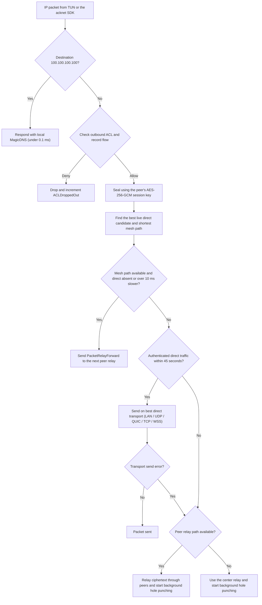

# AckTier capabilities, failover, and relaying

This guide describes the implemented capability matrix, the inner and outer protocol stacks, and how transport selection, relaying, and mesh recovery work.

## 1. Capability matrix

| Area | Capability | Status | Implementation |
| :--- | :--- | :---: | :--- |
| **Control and identity** | Independent owner authorization | Available | Setup pins the owner's Ed25519 key. Nodes verify approvals, rotations, ACLs, and routes against it. See the [owner guide](OWNER_CONTROL.md). |
| | Embedded console | Available | `/admin/` provides initial binding, enrollment keys, requests, members, and publication of signed authorization. Signing keys stay on the owner. |
| | `PreAuthKey` enrollment | Available | Single-use and reusable keys support expiry and revocation. The key submits a request. Signed policy defines node identities and tags. |
| | Stable dual-stack addresses | Available | The owner binds a node key to an IPv4 address in `100.64.0.0/10` and optionally an IPv6 address in `fd7a:115c:a1e0::/48`. |
| | Verified TLS and origin-scoped credentials | Available | Control and center relay use verified TLS outside loopback by default. Startup redacts credentials. Clients scope `NodeToken` to the center origin. |
| | Live `NetMap` streaming | Available | A long-lived HTTP or HTTPS NDJSON stream distributes signed authorization and connection hints. |
| **End-to-end security** | 1-RTT mutual authentication with forward secrecy | Available | The Noise-like handshake uses static and ephemeral X25519 ECDH with HKDF-SHA256. The pending handshake is consumed once in the same critical section to prevent concurrent ACK nonce reuse. |
| | Authenticated encryption and replay protection | Available | `AES-256-GCM` can use AES-NI or ARMv8 acceleration. A 64-bit sliding window tracks replay state. |
| | Authenticated probing and hole punching | Available | `Ping`, `Pong`, and `PunchCoord` carry 128-bit HMAC-SHA256 tags derived per peer and bound to `probeID`. |
| | Exit source isolation and stateful return checks | Available | Default routes are separate from `AllowedIPs`. Subnet routes cannot overlap overlay ranges. Replies must come from the selected exit and match an established outbound flow. |
| **Transports** | Native `UDP` | Available | Low-overhead direct datagrams for broadband and LANs. |
| | `QUIC v1` datagrams and streams | Available | Packets up to 1100 bytes use RFC 9221 datagrams. Larger packets use a unidirectional stream to preserve the MTU. |
| | Multiplexed `TCP` | Available | A full-duplex connection pool multiplexes frames. An inbound connection can carry responses in the reverse direction when NAT limits incoming connections. |
| | `WSS` over TLS 1.3 | Available | Standard HTTPS/WebSocket binary framing works through compatible firewalls, CDNs, and proxies. |
| **NAT traversal and discovery** | Dual-port STUN classification | Available | Detects `open-public`, `cone`, `symmetric` with `PortStep`, and `udp-blocked`. |
| | Layer 2 LAN discovery | Available | UDP beacons on `41921` find peers on the same LAN and allow direct paths. |
| | Router port mapping | Available | UPnP IGDv1/v2 and NAT-PMP automatically request and renew public UDP and TCP mappings. |
| | `CallMeMaybe` coordination | Available | Peers exchange fresh public candidates through a relay and run three rounds of coordinated probes. Symmetric NAT prediction is capped at eight ports. |
| **Automatic routing and relays** | Immediate relay fallback and direct upgrade | Available | Traffic can use a relay while hole punching runs in the background. Subsequent packets move to a live direct path without restarting overlay TCP sessions. |
| | Automatic peer relay eligibility | Available | `RelayMode=auto` considers public interfaces, `open-public` STUN, and UPnP. Ordinary private endpoints skip relay mode. Operators can use `--relay-mode=off` and `--relay-max-mbps`. |
| | Loss and jitter-aware mesh routing | Available | The last 32 probes measure loss and RFC 3550 jitter. `Cost = RTT + 2*Jitter + 300ms*Loss` can favor a better transit path, such as a local public CN2 relay during congestion. |
| | Smoothed scores across four transports | Available | Candidates are probed every 15 seconds. Selection considers smoothed RTT, loss, jitter, and transport weights. |
| | Fast UDP blackhole detection | Available | With continuous outbound traffic, probe after 2.5 seconds without an authenticated reply. Mark the path unusable and fall back after 4.5 seconds without a response. |
| | Multi-hop peer relay | Available | Bounded Dijkstra chooses a relay path of up to four hops. Relays forward ciphertext. |
| | Center and peer relay cost comparison | Available | Compare aggregate mesh cost with measured center relay RTT and a 6 ms center penalty. |
| | Relay detour for a degraded direct path | Available | Use a better relay when the direct path is more than 10 ms slower. |
| | Active roaming on adapter change | Available | `NetMonitor` polls every 1.5 seconds. SDK callers can invoke `NotifyNetworkChange` as soon as the OS reports a change. The engine resets STUN and probes peers. |
| | Single-port center relay | Available | Shares the control HTTP/TLS port through `Upgrade: acktier-relay` to cover paths such as strict symmetric NAT. |
| **Routing and access control** | Userspace subnet router | Available | The layer 3 to layer 4 NAT gateway supports TCP, UDP, and ICMP. Host loopback, IMDS, and local management addresses are blocked. |
| | Exit nodes | Available | Signed routes may include `0.0.0.0/0` or `::/0`. Clients can select, change, or disable their exit. Outbound flow tracking validates replies. |
| | MagicDNS (`100.100.100.100`) | Available | The owner signs node DNS names. The adapter handles `A`, `AAAA`, `PTR`, and `ICMP` locally. |
| | Stateful ACL | Available | Trusts `tag:`, `node:<id>`, `nodekey:`, `group:`, `hosts`, and IP/CIDR selectors. Validates IPv6 extension headers and drops fragments and unknown headers by default. Policy changes and `down` clear sessions and connection tracking. |
| **Clients and SDKs** | Daemon and CLI (`acktierd` and `acktier`) | Available | Builds on Windows with Wintun, Linux with `/dev/net/tun`, and macOS with `utun`. LocalAPI requires a bearer token stored with Unix `0600` or a protected Windows DACL. |
| | Unprivileged embedded SDK (`pkg/acknet`) | Available | Provides `Listen`, `Dial`, `ListenPacket`, `HTTPClient`, and `ListenSOCKS5` without system interface privileges. |
| | Embedded node and API SDK (`pkg/client`) | Available | Provides `client.Node` with status subscriptions and custom TUN, `DaemonClient`, and `AdminClient`. |

## 2. Automatic failover and relaying

AckTier can immediately relay packets, move to direct transport after hole punching, choose among transport protocols, and recompute multi-hop paths after a failure.

### 2.1 Per-packet path selection (`sendWireToPeer`)

The crypto session in `crypto.Manager` is bound to the peer's `NodeKey`. Physical IP, port, protocol, and relay path may change while the overlay TCP connection, HTTP download, or SSH session stays established.

### 2.2 Common scenarios

#### Relay immediately and upgrade to direct

1. When two nodes behind NAT first communicate, the first packet uses an available peer or center relay immediately.
2. `triggerCoordinatedHolePunch` starts in the background with a two-second debounce. The initiating node relays a `PacketPunchCoord` with its latest dual-STUN candidates, NAT type, and port step. The peer returns its candidates. Both send three concurrent probe rounds to advertised and predicted ports while testing QUIC, TCP, and WSS candidates.
3. On an authenticated direct response, `Selector.RecordRx` marks the candidate live. Later packets can go directly.

#### Score and switch transports (`Selector.Score`)

Every 15 seconds the engine probes candidate transports for online peers. It smooths RTT using `EWMA = 0.75 * historicalRTT + 0.25 * currentRTT`. Lower scores are preferred.

$$\text{Score} = \text{SmoothedRTT (ms)} + \text{ProtocolPenalty} + \text{LANBonus}$$

- Protocol penalties are UDP +0 ms, QUIC +1 ms, TCP +3 ms, and WSS +5 ms.
- Same-LAN or private direct candidates receive a −4 ms preference.
- If UDP is blocked or loses enough packets to raise its score, the selector can move to a live QUIC, TCP, or WSS candidate.

#### Multi-hop peer relay and direct-path degradation

1. A node with suitable reachability can explicitly offer to relay with `--can-relay` or `CanRelay: true` in the SDK.
2. New direct links are reported after a 45 ms debounce. Subsequent reports are triggered when RTT changes by more than 25% and 2 ms.
3. `mesh.Router` computes a loop-free path with bounded Dijkstra, up to four hops. Each extra hop adds a 1.5 ms forwarding penalty.
4. A mesh path can carry traffic when hole punching fails or when its total cost plus 10 ms is lower than direct RTT. For example, a 25 ms multi-hop path can replace a 180 ms direct path.

#### Reconnect and reroute after link loss

- `mapStreamLoop` and `RelayClient` reconnect with exponential backoff between 200 ms and five seconds. After recovery, they synchronize the latest topology.
- When a relay such as `Transit-1` goes offline, the center distributes that state. Nodes recalculate routes through another relay such as `Transit-Backup` or the center.

## 3. Recovery under difficult network conditions

The [failover and roaming tests](../internal/daemon/engine/failover_roaming_e2e_test.go) exercise these paths.

1. **Fast UDP blackhole fallback.** `Selector.RecordTx` watches continuous send-without-receive windows, with no extra probes while idle. After 2.5 seconds without an authenticated inbound packet, send a fast probe to avoid misclassifying one-way UDP. After 4.5 seconds without a response, use the best relay for subsequent packets. A recovered direct path can become eligible again.
2. **Measured center relay cost (`selectPathDecision`).** `RelayClient` samples smoothed RTT during handshake and 15-second keepalives and tracks observed relayed peer RTT. A 6 ms preference for peer paths protects center bandwidth while allowing, for example, a 15 ms center path to beat a 180 ms peer route.
3. **Interface roaming (`NetMonitor` and `SyncCandidates`).** Poll interface fingerprints every 1.5 seconds or call `NotifyNetworkChange()` on `client.Node` or `DaemonClient` in response to an OS event. The engine clears old STUN state, probes the new public address, reports a heartbeat, and sends roaming probes to online peers. With the authoritative candidate update, peers retire old addresses and retain predicted ports for still-valid addresses.

**Planned work.** The next phase builds on the Web console with richer topology and change management and uses `pkg/client` for a cross-platform desktop tray application.
