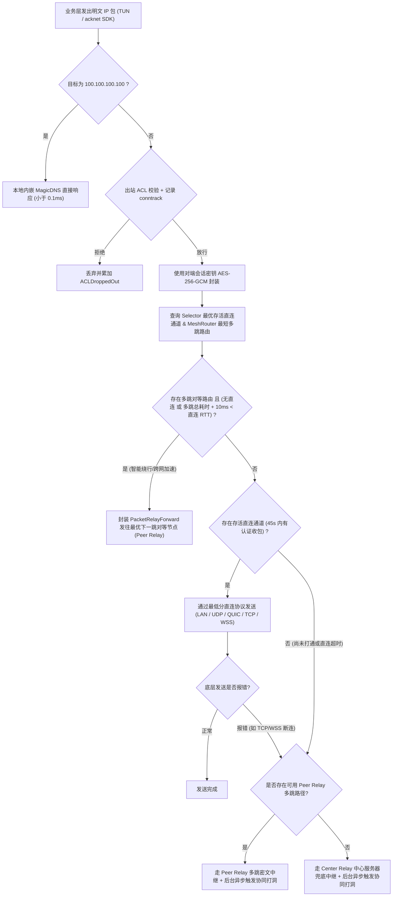

# AckTier 系统能力全景与自动切换/自动中继机制说明

本文档基于当前已落地的代码实现，完整梳理 **AckTier** 的核心能力矩阵、内/外层协议栈支持情况，并重点拆解 **多协议自动选路切换**、**零等待自动中继** 与 **多跳网格故障自愈** 的真实运行逻辑与阈值参数。

---

## 1. 核心能力全景矩阵

| 能力域 | 子能力项 | 当前状态 | 关键实现说明 |
| :--- | :--- | :---: | :--- |
| **控制与身份治理** | 双层公私钥身份 (`MachineKey` / `NodeKey`) | 已支持 | 设备物理身份持久化 + 会话加密公钥解耦 |
| | `PreAuthKey` 预授权密钥体系 | 已支持 | 支持单次/可复用（Reusable）、过期时间、吊销与自动绑定设备 `tag:` |
| | 双栈固定虚拟 IP 分配 (IPAM) | 已支持 | IPv4 `100.64.0.0/10` + IPv6 `fd7a:115c:a1e0::/48`，自动避让 `.0`/`.255` 与 `100.100.100.100` |
| | 实时拓扑流式推送 (`NetMap` Stream) | 已支持 | 基于 HTTP 长连接 NDJSON 增量事件流，节点上下线、路由审批、ACL 变更毫秒级下发 |
| **端到端安全** | 1-RTT 前向保密双向鉴权握手 | 已支持 | 类 Noise 协议（静态+临时双 X25519 ECDH + HKDF-SHA256），每次会话独立临时密钥（PFS） |
| | 业务流量高速加密与防重放 | 已支持 | `AES-256-GCM`（支持 CPU AES-NI / ARMv8 硬件加速）+ 64 位滑动窗口防重放位图 |
| | 内层源 IP 防伪造校验 | 已支持 | 解密后严格校验报文源 IP 是否属于发送方 `AllowedIPs`（防横向 IP 欺骗） |
| **多协议抗封锁传输** | `UDP` 原生直连 | 已支持 | 最低开销数据报通道，常规宽带与内网首选 |
| | `QUIC v1` 混合通道 | 已支持 | 小包（<=1100B）走 RFC 9221 无队头阻塞 Datagram，大包自动走单向流保完整 MTU |
| | `TCP` 长连接复用通道 | 已支持 | 全双工连接池帧复用，支持入站连接反向直接回包（单向出站 NAT 友好），抗 UDP 断流 |
| | `WSS` (WebSocket over TLS 1.3) | 已支持 | 标准 HTTPS/WebSocket 二进制帧封装，可穿透严苛企业防火墙及 CDN/反代 |
| **NAT 穿透与本地发现** | 双端口 STUN NAT 类型精准识别 | 已支持 | 识别 `open-public`、`cone`、`symmetric`（含计算端口递增步长 `PortStep`）与 `udp-blocked` |
| | 局域网二层广播发现 (LAN Discovery) | 已支持 | UDP `41921` 广播信标自动发现同交换机/Wi-Fi 节点，内网千兆直通不绕公网 |
| | 路由器自动端口映射 | 已支持 | 原生集成 `UPnP IGDv1/v2` 与 `NAT-PMP` 自动申请并续期公网 UDP/TCP 端口 |
| | `CallMeMaybe` 双向同步打洞 + 端口预测 | 已支持 | 经中继毫秒级双向交换最新公网地址，发起 3 轮并发打洞及对称型 NAT 相邻端口预测（上限 8 个预测端口防洪泛） |
| **自动切换与自动中继** | 首包零等待中继保底 + 无感升级直连 | 已支持 | 打洞期间流量直接走中继零丢包；直连一旦打通，下一包立即切回直连且 TCP 不断连 |
| | 四协议 EWMA 平滑测速与自动择优 | 已支持 | 后台每 15s 全通道探测，按平滑 RTT + 协议权重自动选出最优协议 |
| | UDP 静默黑洞秒级探活与快速降级 | 已支持 | 连续发包 `2.5s` 无入站回包即主动补发快探针，满 `4.5s` 无响应立即判定直连黑洞并切回中继 |
| | 对等节点多跳密文中继 (`Peer Relay`) | 已支持 | 基于有界 Dijkstra 最短延迟算法（最多 4 跳），中转节点仅转发密文，零明文泄露 |
| | 中心 Relay 与多跳对等中继全局动态比价 | 已支持 | 实时测量中心 Relay RTT（加 `+6ms` 带宽保护权重）与多跳网格总延迟动态PK，谁快走谁 |
| | 直连高延迟劣化自动绕行最优中继 | 已支持 | 当直连延迟比最优中继（Peer 或 Center）慢超过 `10ms` 时，自动绕行更快的低延迟中继链路 |
| | 本机换网（Wi-Fi/热点）瞬间主动漫游通告 | 已支持 | `NetMonitor` 每 `1.5s` 监测网卡变化（支持 SDK `NotifyNetworkChange` 0ms 触发），换网瞬间重置 STUN 并发起全网漫游探针 |
| | 中心服务器单端口兜底中继 (`Center Relay`) | 已支持 | 与控制面共用同一 HTTP/TLS 端口（`Upgrade: acktier-relay`），全网严格对称 NAT 终极保底 |
| **企业级路由与安全** | 免配置防火墙 `Subnet Router`（子网代理） | 已支持 | 纯用户态 L3->L4 TCP/UDP/ICMP NAT 网关，无需配置宿主机 `iptables` 或系统转发 |
| | 全局出口节点 (`Exit Node`) | 已支持 | 支持宣告 `0.0.0.0/0`、`::/0`，客户端按需动态开启/切换/关闭全局出口 |
| | 内嵌 `MagicDNS` (`100.100.100.100`) | 已支持 | 网卡层直接拦截响应 `A`、`AAAA`、`PTR` 与 `ICMP`，非组网域名自动转发上游 DNS |
| | 零信任有状态防火墙 (`Stateful ACL`) | 已支持 | 支持 `tag:`、`group:`、主机别名、端口范围；内置 `conntrack` 放行单向访问后的回包 |
| **多形态接入与 SDK** | 守护进程 + CLI (`acktierd` / `acktier`) | 已支持 | 支持 Windows (`wintun.dll`)、Linux (`/dev/net/tun`)、macOS (`utun`) 三端编译与运行 |
| | 免特权应用内 SDK (`pkg/acknet`) | 已支持 | 对标 Tailscale `tsnet`，零权限提供标准 `Listen`、`Dial`、`ListenPacket`、`HTTPClient`、`SOCKS5` |
| | 节点嵌入与控制 SDK (`pkg/client`) | 已支持 | 提供 `client.Node`（含状态订阅与自定义 TUN）、`DaemonClient`、`AdminClient` |

---

## 2. 自动切换与自动中继工作机制详解

**结论先行：完全支持自动中继、打洞成功后自动切回直连、多协议自动择优切换、以及节点宕机后的多跳自动重路由自愈。**

### 2.1 数据面逐包智能选路流程 (`sendWireToPeer`)

加密会话（`crypto.Manager`）严格与对端身份公钥 `NodeKey` 绑定，**与底层物理 IP、端口、传输协议或中继路径完全解耦**。因此底层通道在 `UDP <-> QUIC <-> TCP <-> WSS <-> Peer Relay <-> Center Relay` 之间任意切换时，**虚拟网内的 TCP 连接、HTTP 下载或 SSH 会话均保持不断开、无需重新握手**。

### 2.2 四大核心自动化场景拆解

#### 场景一：首次连接“零等待自动中继 -> 自动升级 P2P 直连”
1. **首包零等待**：当节点 A 首次访问节点 B（此时双方都在 NAT 后，尚未建立直连），首包**不会阻塞等待打洞**，而是立即通过已连上的 `Peer Relay` 或 `Center Relay` 转发，保证首包 100% 零等待送达。
2. **后台异步双向打洞**：在走中继的同时，引擎自动触发 `triggerCoordinatedHolePunch`（内置 `2s` 防抖冷却）：
   - 节点 A 通过中继向节点 B 发送 `PacketPunchCoord`（携带本机最新双 STUN 探测公网地址、NAT 类型及端口步长）；
   - 节点 B 收到后立即通过中继回传自己的最新公网地址，且**两端在同一时间窗口并发向彼此公网候选地址及预测端口发送 3 轮打洞探针**，同时并发探测 `QUIC` / `TCP` / `WSS` 候选端口。
3. **毫秒级无感切回直连**：一旦任意直连协议收到对端回包，`Selector.RecordRx` 立刻将该端点标记为存活直连，后续数据包自动脱离中继切入直连通道。

#### 场景二：多协议动态评分与抗封锁切换 (`Selector.Score`)
引擎后台每 **15 秒** 对所有在线对等节点的所有候选协议端点发送一次测速探针，使用指数加权移动平均（`EWMA = 0.75 * 历史RTT + 0.25 * 当前RTT`）更新平滑延迟，并按以下公式计算综合得分（**分数越低越优先**）：

$$\text{Score} = \text{SmoothedRTT (ms)} + \text{ProtocolPenalty} + \text{LANBonus}$$

- **协议权重 (`ProtocolPenalty`)**：`UDP: +0ms`、`QUIC: +1ms`、`TCP: +3ms`、`WSS: +5ms`
- **同局域网加成 (`LANBonus`)**：同二层网络自动发现或私网直连端点享受 **`-4.0ms`** 奖励（确保办公室同局域网设备永远优先走内网千兆直连）。
- **自动抗封锁表现**：若当前网络环境中运营商阻断或对 `UDP` 严重限速丢包，导致 `UDP` 无回包或 RTT 飙升，`Selector` 会自动无缝切换至存活且得分更优的 `QUIC`、`TCP` 或 `WSS` 通道。

#### 场景三：对等节点多跳自动中继 (`Peer Relay`) 与劣化绕行
1. **自动开启条件**：网络中任意拥有公网 IP 或优质跨网带宽的节点只需启动时带上 `--can-relay`（或 SDK 中设置 `CanRelay: true`），即成为合法中转候选节点。
2. **全网链路状态收敛**：每当节点间建立新的直连链路，会经过 `45ms` 防抖立即向控制端上报邻居 RTT（日常运行中仅当 RTT 变化超过 `25%` 且大于 `2ms` 时才触发全网广播，避免信令风暴）。
3. **有界 Dijkstra 最短路径**：本地 `mesh.Router` 自动计算最多 **4 跳** 的无环最短延迟路径（每多一跳增加 `1.5ms` 转发惩罚）。
4. **直连劣化自动绕行**：不仅在双方均为严格对称 NAT 打洞失败时自动走 `Peer Relay`；**即便双方存在直连，只要直连质量劣化（`多跳总耗时 + 10ms < 直连 RTT`，例如跨网晚高峰直连 180ms，而经双线公网节点中转仅需 25ms），流量也会自动切向更快的多跳对等中继**。

#### 场景四：链路断开自动重连与重路由自愈
- **控制流与中心中继自愈**：`mapStreamLoop` 与 `RelayClient` 均内置 `200ms ~ 5s` 指数退避无限自动重连机制；网络闪断恢复后自动重连同步最新拓扑。
- **中继节点宕机自愈**：当某台中转节点（如 `Transit-1`）下线断开控制流时，控制端立即向全网推送离线状态，各终端在毫秒级重算 Dijkstra 路径并自动切至备用中继节点（如 `Transit-Backup`）或中心 `Center Relay`，业务流量不中断。

---

## 3. 最新打磨落地的三大极致自愈能力

以下三项针对极端网络环境的秒级自愈优化现已**全部研发落地并通过专项端到端测试验证**（详见 `internal/daemon/engine/failover_roaming_e2e_test.go`）：

1. **UDP 静默断连（黑洞）秒级快速降级（`45s` -> `4.5s`）**
   - `Selector.RecordTx` 实时跟踪直连端点的连续“有发无收”窗口（空闲时零额外发包开销）：一旦持续发包满 **`2.5s`** 未收到任何入站认证包，立即主动补发直连快探针（避免单向 UDP 推流场景误判）；满 **`4.5s`** 仍无回包则当场宣告该直连黑洞失效，下一包毫秒级切回最优中继；原直连恢复后自动切回。
2. **中心 Relay 实测延迟参与全局三层比价 (`selectPathDecision`)**
   - `RelayClient` 在握手及每 `15s` 保活中持续采样到中心服务器的平滑 RTT（同时记录对端经中心中继的端到端实测 RTT），仅附加 `+6.0ms` 轻微权重保护中心服务器带宽。当边缘节点多跳路径过慢（如家用跨网多跳 `180ms` vs 中心云服务器中继 `15ms`）时，引擎自动优选更快的 `Center Relay`。
3. **本机网卡切换瞬间主动漫游与旧 IP 即时淘汰 (`NetMonitor` + `SyncCandidates`)**
   - 内置跨平台网卡指纹监听器（默认 `1.5s` 轮询，并在 `client.Node` / `DaemonClient` 暴露 `NotifyNetworkChange()` 供系统事件 0ms 触发）：换网瞬间清空旧 STUN 缓存、重探新公网地址、上报即时心跳并向所有在线对等节点发送漫游探针；对端收到权威端点列表后自动通过 `SyncCandidates` 立即淘汰已失效的旧网卡 IP（同时保留有效 IP 上的对称 NAT 预测打洞端口），实现百毫秒级 Wi-Fi <-> 5G 无感漫游。

**下一阶段演进重点（阶段五）**：
- 基于现有 Admin REST API 与公开 `pkg/client` SDK，构建控制端内嵌 **Web 管理控制台** 及 Windows / macOS / Linux **跨平台桌面图形客户端（系统托盘 GUI）**。
