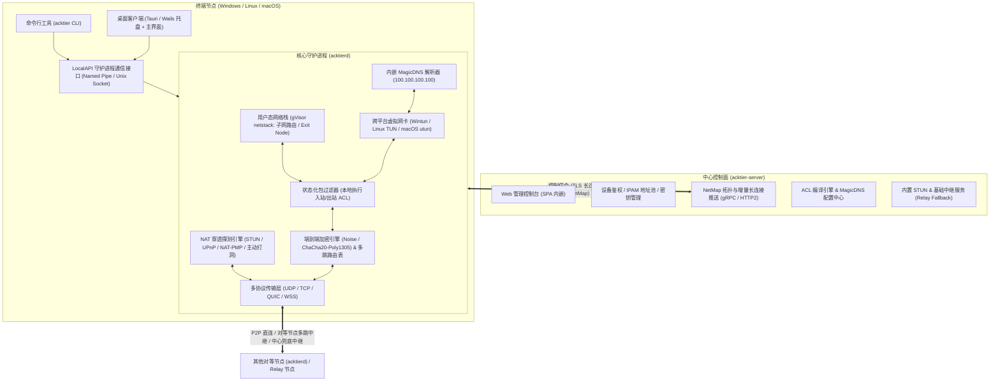
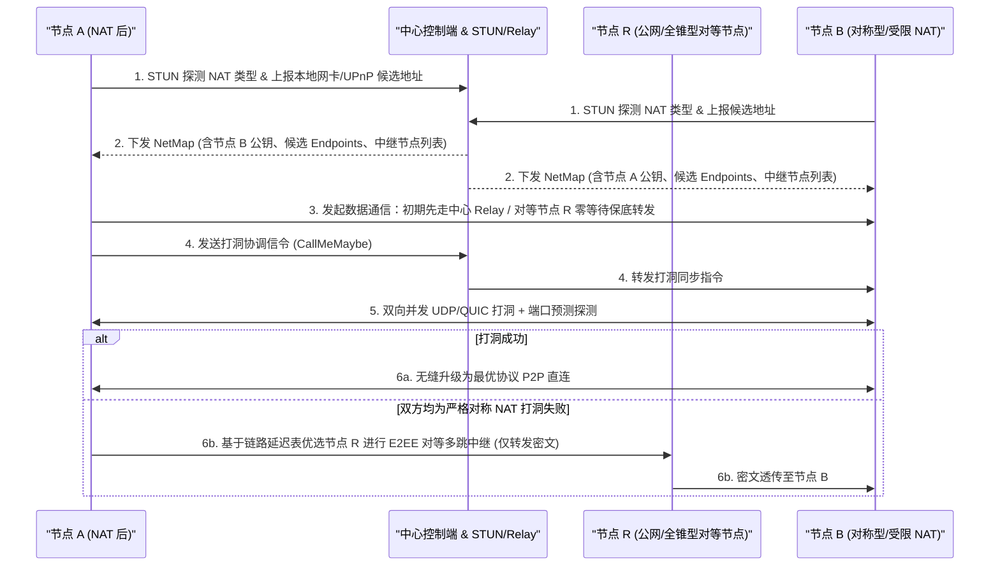

# AckTier 异地组网项目规划书

## 1. 项目定位与核心设计理念

**AckTier** 是一款基于 **Go 语言** 构建的新一代跨平台异地组网（SD-WAN / Overlay Mesh VPN）系统，面向 **Windows、Linux、macOS** 全桌面及服务器环境提供开箱即用的零信任虚拟局域网能力。

项目在架构上深度融合 **Tailscale** 与 **EasyTier** 两代工具的核心优势，解决单一架构在国内及复杂企业网络环境下的痛点：

| 维度 | Tailscale 模式 | EasyTier 模式 | AckTier 融合方案 |
| :--- | :--- | :--- | :--- |
| **控制与治理** | 中心协调端统一鉴权、IP 分配、ACL 与 MagicDNS，管理体验极佳 | 去中心化无状态组网为主，缺乏集中式企业级设备治理与统一 ACL | **中心控制面（Control Server）**：统一设备注册、PreAuthKey/OAuth 鉴权、IPAM、拓扑下发与零信任 ACL |
| **传输抗封锁** | 数据面强绑定 WireGuard (UDP)，遭遇运营商 UDP QoS 或严格防火墙时易退化至低速中继 | 原生支持 UDP / TCP / WSS / QUIC 等多协议传输，穿墙与抗 QoS 能力强 | **多协议可插拔传输层**：原生支持 `UDP`、`TCP`、`QUIC`、`WebSocket (WSS)` 自动测速选路与无缝切换 |
| **中继与路由** | 仅支持官方/自建 DERP 单跳中继，无法利用优质公网对等节点中转 | 支持网状多跳路由（OSPF 类链路状态），任意公网/优质节点可协助中转 | **中心 Relay + 智能对等多跳中继（Peer Relay）**：打洞失败时自动计算全网延迟最低路径（含对等节点一跳/多跳中转） |
| **子网与免配置转发** | 借助用户态 `netstack` 实现免改宿主机防火墙的出口与子网路由 | 内置用户态协议栈，免驱动/无感代理子网 | **混合数据栈（TUN + gVisor Netstack）**：本地虚拟网卡透明互通 + 用户态协议栈无感实现 Subnet Router 与 Exit Node |

> [!IMPORTANT]
> **核心架构原则：控制面与数据面彻底解耦**
> 中心控制端（`acktier-server`）**绝不触碰任何用户业务流量明文**，仅负责公钥交换、虚拟 IP 分配、网络拓扑（NetMap）增量推送与安全策略下发；所有业务流量均在客户端守护进程（`acktierd`）之间基于公私钥进行 **端到端加密（E2EE）** 传输。

---

## 2. 总体系统架构



---

## 3. 核心模块详细设计

### 3.1 中心控制面 (`acktier-server`)
1. **身份与密钥体系**
   - **双层密钥模型**：每个节点自动生成持久化的 `MachineKey`（设备物理身份标识）与可轮换的 `NodeKey`（网络会话加密公钥），支持通过浏览器交互登录、命令行授权链接或无人值守 `PreAuthKey`（预授权密钥）接入。
2. **IPAM（虚拟地址管理）**
   - 默认分配 `100.64.0.0/10`（CGNAT 段，避免与常见局域网 `192.168.x.x` / `10.x.x.x` 冲突）下的固定 IPv4 地址，以及 `fd7a:115c:a1e0::/48` 下的 IPv6 ULA 地址。
3. **实时 NetMap 增量流式同步**
   - 客户端与控制端保持一条轻量级流式连接（HTTP/2 Connect 或 gRPC Stream）。当全网有节点上下线、公网 Endpoint 变更、宣告新子网或管理员修改 ACL 时，控制端在毫秒级将 **增量补丁（Delta NetMap）** 推送给相关受影响节点。
4. **内置 Web 管理后台**
   - 编译为静态资源内嵌进 `acktier-server` 单一二进制文件，支持可视化查看在线节点、延迟拓扑、审批子网路由、签发 PreAuthKey、编辑 ACL 规则与配置 MagicDNS。

### 3.2 多协议传输与智能选路 (`pkg/transport` & `pkg/magicsock`)
为解决单一 UDP 协议在跨省/跨国或校园企业网中被限流阻断的问题，设计统一的数据帧传输抽象接口：
- **UDP 原生通道**：最低开销、最高吞吐，局域网与常规宽带打洞首选。
- **QUIC 通道 (`quic-go`)**：自带多路复用、拥塞控制（BBR/Cubic）与连接迁移能力，弱网抗丢包表现优异。
- **TCP / WebSocket (WSS) 通道**：伪装为标准 HTTPS WebSocket 流量，支持穿透仅放行 80/443 端口的严格企业防火墙及 CDN 反代中转。
- **动态探针与无感切换**：后台周期性对可用链路发送加密 Ping 探针，综合 RTT 延迟、抖动与丢包率动态评分，直连打洞成功后毫秒级从 Relay 切回最优直连协议，TCP/连接不断开。

### 3.3 NAT 穿透与多跳网格路由 (`pkg/nat` & `pkg/mesh`)

- **分层穿透策略**：
  1. **同局域网发现（LAN Discovery）**：基于本地广播/组播发现同二层网络设备，内网千兆/万兆直通，不绕公网。
  2. **主动端口映射**：支持 UPnP、NAT-PMP、PCP 自动向家用路由器申请公网端口映射。
  3. **并发协调打洞**：通过信令同步两端同时发包穿透锥型 NAT；针对轻度对称型 NAT 引入相邻端口探测策略。
  4. **对等节点智能多跳中继（Peer Relay）**：参考 EasyTier 设计，允许拥有公网 IP 或优质带宽的普通节点开启“允许作为对等中继”开关。中继节点仅根据路由头转发已加密载荷，无法解密任何业务数据，彻底消除单一中心 DERP 带宽瓶颈。

### 3.4 端到端加密与数据面 (`pkg/dataplane`)
- **握手与会话加密**：采用基于 **Noise_IK** 协议框架（与 WireGuard 同源密码学原语：`X25519` 密钥交换 + `ChaCha20-Poly1305` / `AES-256-GCM` AEAD 硬件加速自适应加密 + `BLAKE2s`），支持前向安全性（PFS）与定期会话密钥自动轮换。
- **跨平台虚拟网卡适配**：
  - **Windows**：集成高性能 `Wintun` 驱动（内核态零拷贝环形缓冲区）。
  - **Linux**：标准 `/dev/net/tun` 接口（支持多队列 IFF_MULTI_QUEUE 优化）。
  - **macOS**：系统原生 `utun` 接口。

### 3.5 子网代理、出口节点与用户态协议栈 (`pkg/subnet`)
- **Subnet Router（子网路由）**：内网只需部署一台 AckTier 节点并宣告网段（如 `192.168.10.0/24`），控制端审批后自动将该路由注入授权节点的虚拟网卡路由表。转发端内置 **gVisor `netstack` 用户态 TCP/IP 协议栈**，将虚拟网流量直接转换为宿主机出站 Socket 请求，**无需手动配置复杂的系统 `iptables` / Windows 路由转发与源地址伪装（SNAT）**。
- **Exit Node（全局出口节点）**：一键将某台节点设为全局互联网出口，自动处理路由防环（排除控制端及对等传输通道 IP）与远程 DNS 防泄漏转发。

### 3.6 MagicDNS 与零信任 ACL (`pkg/dns` & `pkg/acl`)
- **MagicDNS**：客户端在本地虚拟地址 `100.100.100.100` 启动内嵌 DNS 服务，并按平台规范注入系统分流解析（Windows NRPT 策略 / Linux `systemd-resolved` / macOS `/etc/resolver/`），实现直接通过主机名（如 `nas.ack.net`）访问组网设备，不影响正常公网域名解析。
- **细粒度 ACL 访问控制**：管理员在控制端使用直观的 JSON/HuJSON 或可视化矩阵定义规则（支持按用户、设备标签 `tag:server`、IP/网段、协议与端口范围授权）。控制端将全局规则编译为针对每台节点的最小权限包过滤指令集，由客户端数据面在收发包时执行有状态过滤（Stateful Packet Filter）。

---

## 4. 全桌面端与跨平台交互方案

由于需要在 **Windows、Linux、macOS** 三端同步提供优质桌面体验，采用 **“系统级特权服务进程 (`acktierd`) + 无特权图形前端 (`acktier-gui`)”** 的标准分离架构（避免每次打开界面都弹出 UAC/sudo 提权弹窗）：

1. **后端服务 (`acktierd`)**：以 Windows Service / Linux `systemd` / macOS `LaunchDaemon` 形式开机自启运行，持有操作虚拟网卡与系统路由的权限，在本地暴露带权限校验的 `LocalAPI`（Windows Named Pipe / Unix Domain Socket）。
2. **桌面图形客户端与 Web 控制台复用一套前端技术栈**：
   - **推荐方案：Tauri v2（或 Wails v2）+ React / TypeScript + TailwindCSS**
     - *注*：由于核心引擎全部在 `acktierd`（Go 守护进程）中实现，桌面 GUI 仅作为极轻量的状态展示、开关控制、节点延迟查看与系统托盘（System Tray）交互壳。使用 **Wails** 可保持 100% 纯 Go 工具链（无需额外配置 Rust 编译环境），使用系统原生 WebView2 / WebKit，安装包体积仅 **5~8 MB**，内存占用极低；同时前端组件库可与 `acktier-server` 的 Web 管理后台共享设计体系！

---

## 5. 代码仓库工程目录结构规划 (Monorepo)

采用 Go 模块化单仓设计，清晰隔离公共协议、服务端、客户端守护进程与前端工程：

```text
acktier/
├── cmd/
│   ├── acktier-server/      # 中心控制端入口 (含内嵌 Web Console & Relay)
│   ├── acktierd/            # 跨平台客户端后台守护进程服务入口
│   └── acktier/             # 跨平台 CLI 命令行控制工具
├── internal/
│   ├── server/              # 控制端核心逻辑
│   │   ├── auth/            # 设备鉴权、PreAuthKey、用户会话管理
│   │   ├── ipam/            # IPv4/IPv6 地址池分配器
│   │   ├── mapserver/       # NetMap 构建与增量长连接推送引擎
│   │   ├── acl/             # ACL 策略解析与单节点过滤规则编译器
│   │   ├── store/           # 存储抽象层 (默认内嵌 SQLite / 可选 PostgreSQL)
│   │   └── webapi/          # 管理后台 REST API
│   └── daemon/              # 客户端守护进程核心逻辑
│       ├── engine/          # 核心状态机：统筹控制连接、网卡、路由与加密会话
│       ├── tun/             # 跨平台 TUN 封装 (Windows Wintun / Linux / macOS)
│       ├── crypto/          # Noise 握手协议与 AEAD 高速数据加解密会话池
│       ├── transport/       # 多协议传输实现 (UDP / TCP / QUIC / WSS)
│       ├── nat/             # STUN 客户端、UPnP/NAT-PMP、主动打洞协调器
│       ├── mesh/            # 链路探测评分、最优路径计算与 Peer 多跳密文中继
│       ├── netstack/        # 基于 gVisor 的用户态协议栈 (Subnet Router & Exit Node)
│       ├── dns/             # MagicDNS 本地服务器与跨平台系统 DNS 配置器
│       ├── filter/          # 本地有状态包过滤防火墙 (执行 ACL)
│       ├── localapi/        # 供 CLI 和桌面 GUI 调用的本地 IPC 服务
│       └── sysservice/      # 跨平台系统服务安装/启停管理 (SCM / systemd / launchd)
├── pkg/
│   ├── protocol/            # 控制面与数据面协议定义 (Protobuf / 二进制帧格式)
│   └── types/               # 公共数据结构 (Node, NetMap, Endpoint, FilterRule)
├── web/
│   ├── console/             # 控制端 Web 管理后台前端 (React + Vite + Tailwind)
│   └── desktop/             # 跨平台桌面客户端 GUI 工程 (Wails / Tauri + 系统托盘)
├── scripts/                 # 跨平台构建、打包脚本 (MSI/NSIS, DEB/RPM, DMG/PKG)
└── docs/                    # 架构文档、协议规范与部署指南
```

---

## 6. 核心技术选型清单

| 模块领域 | 选型组件 / 库 | 选型理由 |
| :--- | :--- | :--- |
| **核心语言** | Go 1.23+ | 协程并发模型极契合海量网络 Socket 调度，跨平台交叉编译能力极强 |
| **控制面通信** | ConnectRPC / gRPC + Protobuf | 强类型协议契约，原生支持 HTTP/2 双向流式增量推送，易穿透反代 |
| **虚拟网卡驱动** | `golang.zx2c4.com/wireguard/tun` | 经过 Tailscale/WireGuard 亿级终端验证的跨平台 TUN 库（含 Wintun 绑定） |
| **用户态网络栈** | `gvisor.dev/gvisor/pkg/tcpip` | 纯 Go 高性能用户态 TCP/IP 栈，优雅实现免改防火墙的子网代理与出口节点 |
| **密码学套件** | `golang.org/x/crypto` (X25519 / ChaCha20Poly1305) | 官方维护标准加密原语，支持硬件 AES-NI / ARMv8 加速自适应 |
| **多协议传输** | 标准库 `net` + `quic-go` + `coder/websocket` | 成熟稳定的高性能 QUIC 与 WebSocket 实现 |
| **数据库存储** | `modernc.org/sqlite` (纯 Go 无 CGO) | 服务端零外部依赖单文件部署，免 CGO 方便跨平台编译；预留 PostgreSQL 接口 |
| **系统服务管理** | `kardianos/service` | 统一封装 Windows Service、Linux systemd、macOS Launchd |
| **桌面端 GUI** | Wails v2 (推荐) 或 Tauri v2 + React | Wails 纯 Go 编译链无缝衔接，轻量原生 WebView + 系统托盘支持 |

---

## 7. 分阶段研发路线图 (Roadmap)

我们将项目拆分为 **6 个可独立交付、逐步演进的里程碑阶段**，确保每一步都有可实际运行验证的闭环产物：

### 阶段一：最小闭环骨架与基础组网 (Phase 1 - MVP)
- **目标**：跑通“控制端注册 -> 虚拟 IP 分配 -> 两台跨平台设备建立加密虚拟网卡互通（先基于 UDP 直连 + 中心基础中继）”。
- **交付内容**：
  - 初始化 Go 工程架构与 Protobuf 控制/数据帧协议定义。
  - 实现 `acktier-server` 核心：SQLite 存储、PreAuthKey 鉴权、IPAM 地址分配、NetMap 流式同步、内置基础 Relay 服务。
  - 实现 `acktierd` 与 `acktier` CLI：Windows/Linux/macOS 三端 TUN 虚拟网卡创建、Noise 端到端加密隧道、UDP 直连与中心 Relay 兜底通信（成功 `ping` 通对端 `100.64.0.x`）。

### 阶段二：NAT 穿透引擎与多协议传输层 (Phase 2 - Connectivity)
- **目标**：大幅提升复杂网络下的直连率与弱网抗封锁能力。
- **交付内容**：
  - 内置 STUN 探测服务与客户端 NAT 类型识别、局域网多播直连发现（LAN Discovery）、UPnP/NAT-PMP 自动端口映射。
  - 实现双向协调 UDP 打洞与端口预测穿透。
  - 抽象统一 `Transport` 层，接入 **TCP、QUIC、WebSocket (WSS)** 传输通道，实现多路径 RTT 测速与无感切换。

### 阶段三：智能对等多跳中继与网格选路 (Phase 3 - Smart Mesh)
- **目标**：引入 EasyTier 式网格中继能力，彻底摆脱单一中心服务器带宽瓶颈。
- **交付内容**：
  - 实现对等节点中继（Peer Relay）开关与密文路由转发头设计。
  - 实现节点间链路质量上报与最短延迟路径计算（支持一跳及多跳最优节点中转，端到端密文不落地）。

### 阶段四：子网代理、出口节点、MagicDNS 与零信任 ACL (Phase 4 - Enterprise Networking)
- **目标**：补齐高级路由与零信任安全管控能力。
- **交付内容**：
  - 集成 `gVisor netstack` 实现免配置防火墙的 **Subnet Router（子网打通）** 与 **Exit Node（全局出口节点）**。
  - 实现跨平台 **MagicDNS**（`100.100.100.100` 内嵌解析器 + Windows/Linux/macOS 系统分流解析配置）。
  - 实现控制端 ACL 策略编译器与客户端有状态包过滤引擎（按设备/标签/端口细粒度隔离）。

### 阶段五：Web 管理控制台与全桌面端 GUI 客户端 (Phase 5 - UI & Desktop)
- **目标**：交付完整的图形化管理与终端用户一键组网体验。
- **交付内容**：
  - 开发 `acktier-server` 内嵌 Web 管理控制台（节点管理、拓扑延迟可视化、路由审批、密钥管理、ACL 编辑器）。
  - 开发 Windows / macOS / Linux 全桌面图形客户端（系统托盘常驻、一键连接/断开、节点列表与直连/中继协议状态展示、一键切换 Exit Node）。
  - 完善系统后台服务（Windows Service / systemd / LaunchDaemon）开机自启与无感提权交互。

### 阶段六：性能优化、安全审计与跨平台安装包分发 (Phase 6 - Production Ready)
- **目标**：达到生产级吞吐量、稳定性与一键安装体验。
- **交付内容**：
  - 数据面零内存分配（Zero-copy buffer pool）、GSO/GRO 批量收发包优化，压测千兆以上虚拟网吞吐。
  - 自动化构建流水线：打包 Windows (`.msi` / `.exe` 含 Wintun 自动部署)、macOS (`.pkg` / `.dmg`)、Linux (`.deb` / `.rpm` / Docker 镜像)。
