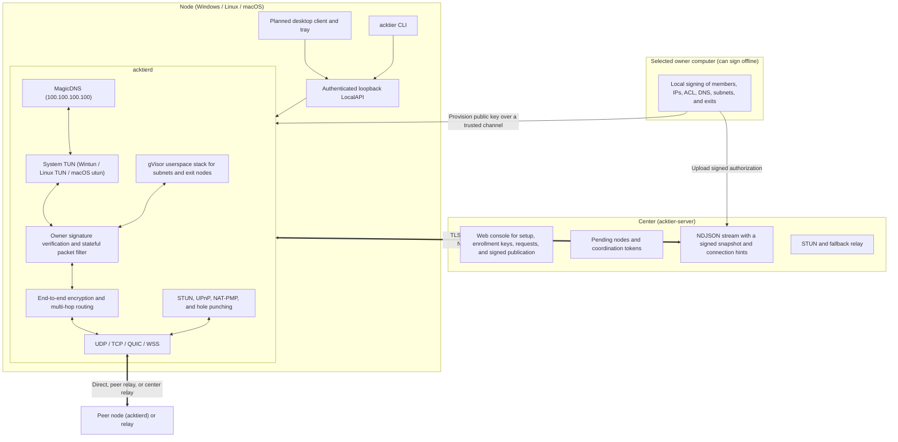
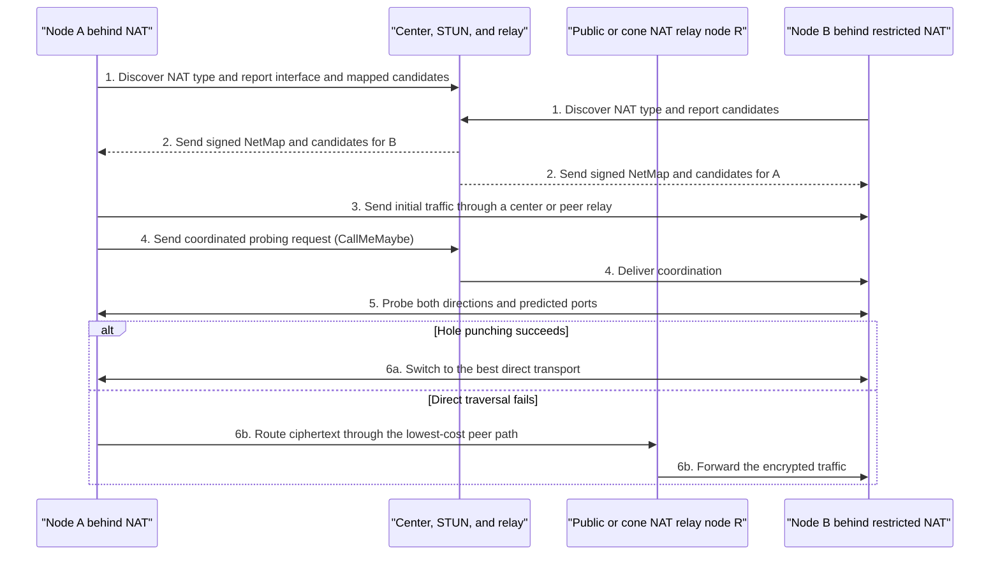

# AckTier overlay networking project plan

## 1. Product and design

AckTier is a Go-based overlay mesh VPN for Windows, Linux, and macOS desktops and servers. It combines owner-signed identity and policy with central coordination, multiple transports, and peer relays.

Tailscale and EasyTier inspired different parts of the design. The following table describes the goals of this project.

| Area | Tailscale-inspired design | EasyTier-inspired design | AckTier design |
| :--- | :--- | :--- | :--- |
| Control and policy | Central coordination, addressing, ACL, and MagicDNS | Decentralized mesh operation | A selected owner signs identities, overlay IPs, ACLs, and routes. The center collects requests and distributes signed policy and connection hints. |
| Transport | WireGuard over UDP with relay fallback | UDP, TCP, WSS, and QUIC | Measure multiple transports and switch between UDP, TCP, QUIC, and WSS as paths change. |
| Relaying | Center-based relays | Link-state mesh routing and transit peers | Use center relay or a lower-cost one-hop or multi-hop peer route when direct connectivity is unavailable or degraded. |
| Subnets and egress | Userspace networking for routed subnets and exits | Embedded userspace stack | Combine system TUN with gVisor netstack for subnet routers and exit nodes without host forwarding rules. |

> [!IMPORTANT]
> Signing belongs to the selected owner. The center handles public material and distributes signed policy. Nodes verify the owner signature before accepting identities. Relays forward ciphertext. See the [owner architecture](OWNER_CONTROL.md).

## 2. System architecture

The diagram includes the planned desktop interface. See [capabilities](CAPABILITIES.md) for implemented functionality.



## 3. Core modules

### 3.1 Owner and center (`acktier-server`)

1. **Identity and keys.** Nodes generate `MachineKey` and an X25519 `NodeKey` locally. Before enabling enrollment, a center administrator imports the selected owner's Ed25519 public key through the setup console. `PreAuthKey` submits a request.
2. **Overlay addresses and access.** The owner signs each `NodeKey`, fixed IPv4 in `100.64.0.0/10` and optional IPv6 in `fd7a:115c:a1e0::/48`, ACL, DNS, approved subnets, and exits. Nodes use only verified authorization.
3. **NetMap streaming.** HTTP(S) NDJSON carries a complete signed snapshot and dynamic hints. The center updates candidates, online state, and link quality. Signing versions are separate from stream revisions and resist rollback across restarts.
4. **Web console.** Initial binding, node and request views, enrollment keys, drafts, and publication of signed snapshots are available. The owner verifies and signs with the local CLI. The roadmap includes expanding topology and change-management tools.

#### Threat model for a compromised center

The model assumes the center can be fully compromised while the owner key and node state remain protected. Nodes already pin the public owner key from a trusted source. A valid TLS certificate or center admin credential authorizes only its own surface.

Nodes install only owner-signed keys, addresses, ACL, DNS, and routes. They verify network ID, version, and expiry and reject unsigned changes, rollback, and replay. Received signed revocations clear prior authorization. A center outage or rejection denies coordination.

A compromised center can observe metadata, withhold updates, affect path selection, and stop relaying. A withheld revocation takes effect by the old signature's expiry. Multi-node failure and upgrade tests, independent emergency revocation, and root rotation remain release work. See [outages and recovery](OWNER_CONTROL.md#outages-compromise-and-recovery).

### 3.2 Transport and path selection

A shared frame transport interface serves networks where UDP is throttled or blocked.

- **UDP.** Direct low-overhead datagrams for LAN and typical broadband paths.
- **QUIC (`quic-go`).** Multiplexing, congestion control, and connection migration for lossy paths.
- **TCP and WSS.** Reliable streams and standard HTTPS WebSocket framing for networks or proxies that accept those transports.
- **Probes and switching.** Authenticated probes score RTT, jitter, and loss. An established overlay session can move from a relay to a live direct transport.

### 3.3 NAT traversal and mesh routing



1. **LAN discovery.** Broadcast or multicast finds peers on the same layer 2 network for direct communication.
2. **Port mapping.** UPnP and NAT-PMP request a public mapping. PCP is a design option.
3. **Coordinated probing.** Peers send concurrently. Adjacent port prediction can help with some symmetric NATs.
4. **Peer relays.** Eligible public or well-connected nodes can opt into transit. They forward encrypted payloads using routing headers and can reduce reliance on center bandwidth.

### 3.4 End-to-end encryption and data plane

- **Handshake and sessions.** The design uses a Noise-like handshake with X25519 and forward secrecy. The deployed data plane uses authenticated AES-256-GCM. ChaCha20-Poly1305 and alternate Noise primitives were considered as part of the design.
- **System TUN.** Windows uses Wintun ring buffers, Linux uses `/dev/net/tun`, and macOS uses `utun`. Linux multiqueue is an optimization target.

### 3.5 Subnet routers, exit nodes, and userspace networking

- **Subnet router.** A node advertises a network such as `192.168.10.0/24`. The owner signs the approval, and eligible nodes can install the route. The forwarding node uses gVisor netstack to originate host sockets from overlay traffic without system forwarding or SNAT configuration.
- **Exit node.** A client can select a signed internet exit. Route exclusions keep control and peer transports reachable. The design includes remote DNS forwarding to keep resolution on the intended path.

### 3.6 MagicDNS and ACLs

- **MagicDNS.** The local resolver listens at `100.100.100.100`. Split resolver integrations include Windows NRPT, Linux `systemd-resolved`, and macOS `/etc/resolver/`. A name such as `nas.ack.net` can resolve inside the overlay without affecting public DNS.
- **ACLs.** The policy format and editor define rules using authorized identities, tags, IPs, CIDRs, protocols, and ports. The owner compiles and signs the policy. Each data plane applies stateful filtering to traffic.

## 4. Desktop and cross-platform experience

The desktop plan pairs a privileged `acktierd` service with an unprivileged GUI. The daemon holds TUN and routing permissions. The GUI talks to authenticated LocalAPI without elevating on each launch.

1. **Platform service.** Proposed integration targets are Windows Service, Linux `systemd`, and macOS `LaunchDaemon`. The current CLI uses authenticated loopback HTTP. Named pipes and domain sockets were considered for platform IPC.
2. **Desktop shell.** Wails v2 and Tauri v2 are candidates for a TypeScript front end and tray. Wails uses the Go toolchain and the platform's WebView2 or WebKit. A compact 5–8 MB shell is a design estimate. The GUI can share the console's design components while using the daemon for engine operations.

## 5. Repository layout plan

The planned monorepo separates public types and protocols from coordination, daemon internals, and front ends. Some names below describe design areas that may be implemented in other directories.

```text
acktier/
├── cmd/
│   ├── acktier-server/      # Center, console, and relay entry point
│   ├── acktierd/            # Cross-platform daemon
│   └── acktier/             # CLI
├── internal/
│   ├── server/              # Center internals
│   │   ├── auth/            # Device and session authentication
│   │   ├── ipam/            # Overlay address pools
│   │   ├── mapserver/       # NetMap generation and streaming
│   │   ├── acl/             # ACL parser and packet filter compiler
│   │   ├── store/           # SQLite persistence
│   │   └── webapi/          # Management REST API
│   └── daemon/              # Node daemon internals
│       ├── engine/          # Control, TUN, routes, and sessions
│       ├── tun/             # Wintun, Linux TUN, and macOS utun
│       ├── crypto/          # Handshake and authenticated encryption
│       ├── transport/       # UDP, TCP, QUIC, and WSS
│       ├── nat/             # STUN, mapping, and coordinated probes
│       ├── mesh/            # Link cost, path selection, and peer forwarding
│       ├── netstack/        # gVisor subnet and exit networking
│       ├── dns/             # MagicDNS and platform resolver setup
│       ├── filter/          # Stateful ACL
│       ├── localapi/        # Local CLI and GUI API
│       └── sysservice/      # Proposed cross-platform service management
├── pkg/
│   ├── protocol/            # Control and binary data-plane framing
│   └── types/               # Shared node, map, endpoint, and filter types
├── web/
│   ├── console/             # Proposed console front-end workspace
│   └── desktop/             # Planned desktop GUI
├── scripts/                 # Build and packaging tools
└── docs/                    # Architecture, protocol, and deployment guides
```

## 6. Technology choices

| Area | Component or option | Reason |
| :--- | :--- | :--- |
| Language | Go, with the version pinned in `go.mod` | Concurrent networking and cross-compilation |
| Control protocol | NDJSON over HTTP(S). ConnectRPC, gRPC, and Protobuf were design options. | Stream node and policy state through a proxy-compatible connection |
| System adapter | `golang.zx2c4.com/wireguard/tun` and Wintun | Cross-platform system TUN support |
| Userspace stack | `gvisor.dev/gvisor/pkg/tcpip` | TCP/IP stack for subnet routes and internet exits |
| Cryptography | Go crypto libraries and `golang.org/x/crypto` | Standard algorithms and hardware AES support |
| Transport | `net`, `quic-go`, and `coder/websocket` | UDP, streams, QUIC, and WebSockets |
| Storage | `modernc.org/sqlite` | Single-file center state and CGO-free cross-compilation. PostgreSQL was considered. |
| Service integration | `kardianos/service` is a design option | Windows Service, systemd, and launchd |
| Desktop GUI | Wails v2 or Tauri v2 with a Web front end | Native WebView and tray integration |

## 7. Roadmap

### Phase 1. Basic encrypted network

- Define the Go project, control messages, and data-plane framing.
- Deliver the center with SQLite, enrollment keys, IP allocation, NetMap streaming, and basic relay.
- Deliver daemon and CLI with Windows, Linux, and macOS TUN, encrypted UDP, and center fallback. Verify overlay traffic between two nodes.

### Phase 2. NAT traversal and transports

- Add STUN classification, LAN discovery, and UPnP/NAT-PMP mapping.
- Add bidirectional hole punching and port prediction.
- Support TCP, QUIC, and WSS with shared RTT measurement and path selection.

### Phase 3. Multi-hop peer relays

- Add peer relay eligibility and ciphertext routing headers.
- Report link quality and compute optimal direct, one-hop, and multi-hop paths.

### Phase 4. Routing, DNS, and ACL

- Implement subnet routing and exit nodes with gVisor userspace networking.
- Provide the `100.100.100.100` MagicDNS resolver and platform split DNS.
- Compile signed policy and enforce stateful filtering by node, tag, and port.

### Phase 5. Console and desktop GUI

- Extend the embedded console with topology and change drafts. Approval and signing stay on the owner.
- Develop a Windows, Linux, and macOS GUI and tray with connect, disconnect, node, relay, and exit controls.
- Add platform services and a streamlined elevation flow.

### Phase 6. Production performance, security, and distribution

- Verify multi-node upgrades, failure recovery, and backup restore. Plan independent emergency revocation and owner root rotation.
- Evaluate allocation-free buffers, GSO/GRO batching, and throughput above 1 Gbps.
- Expand automated builds and platform packages such as Windows installers with Wintun, macOS packages, Linux packages, and container images. See the [current package guide](INSTALL.md).
